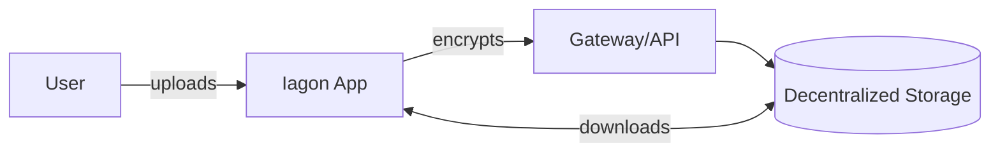
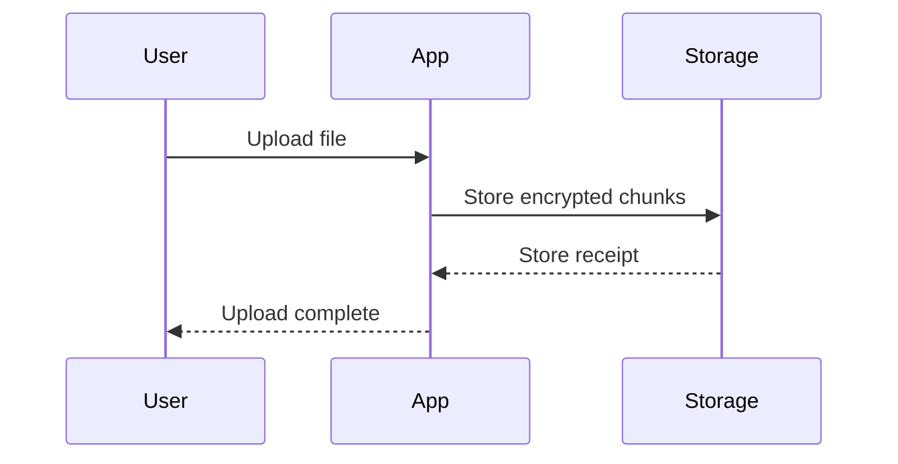

# This is an h1 title

To use only 1 per page, at the top. As you can see there is no line separator underneath this section

## This is an h2 title

Lorem ipsum dolor sit amet, consectetur adipiscing elit, sed do eiusmod tempor incididunt ut labore et dolore magna aliqua. Ut enim ad minim veniam, quis nostrud exercitation ullamco laboris nisi ut aliquip ex ea commodo consequat.

### This is an h3 title

Lorem ipsum dolor sit amet, consectetur adipiscing elit, sed do eiusmod tempor incididunt ut labore et dolore magna aliqua. 

#### This is an h4 title (same style for h5 and h6)

Lorem ipsum dolor sit amet, consectetur adipiscing elit, sed do eiusmod tempor incididunt ut labore et dolore magna aliqua.

## This is an OL with some text links
1. [Authenticate](#this-is-an-ol-with-some-links) to obtain your API credentials
2. Make your first API call to any of the [available endpoints](#this-is-an-ol-with-some-links)
3. Handle responses and errors appropriately

## This is an UL with &lt;strong&gt; starting
- **Lorem del Ipsum** ipsum dolor sit amet, consectetur adipiscing elit
- **Lorem del Ipsum** ipsum dolor sit amet, consectetur adipiscing elit
- **Lorem del Ipsum** ipsum dolor sit amet, consectetur adipiscing elit
- **Lorem del Ipsum** ipsum dolor sit amet, consectetur adipiscing elit

## This is a 1 liner generic code box + inline code
```
https://api.fireblocks.partners.iagon.com
```
Lorem ipsum dolor sit amet, consectetur adipiscing elit `inline code (click-to-copy)`

## This is a code element
Lorem ipsum dolor sit amet, consectetur adipiscing elit, sed do eiusmod tempor incididunt ut labore et dolore magna aliqua. Ut enim ad minim veniam, quis nostrud exercitation.

```JSON
{
  "success": false,
  "data": {
    // Response data
      }
}
```

## This is a random table

Lorem ipsum dolor sit amet, consectetur adipiscing elit, sed do eiusmod tempor incididunt ut labore et 
dolore magna aliqua. Ut enim ad minim veniam, quis nostrud exercitation.

| Parameter          | Data Type | Description                                                                                                                      | Other        |
| ------------------ | --------- | -------------------------------------------------------------------------------------------------------------------------------- | ------------ |
| `transaction_id`   | string    | Lorem ipsum dolor sit amet, consectetur adipiscing elit, sed do eiusmod tempor incididunt ut labore et dolore sit balancia        | Random thing |
| `output_index`     | number    | Output index within the transaction                                                                                              | Random       |
| `epoch_length`     | integer   | Number of slots per epoch (432000 for mainnet)                                                                                   | BlaBla       |
| `output_index`     | number    | Output index within the transaction                                                                                              | Random       |
| `slot`             | integer   | Absolute slot number (use this for TTL calculation)                                                                              | Word         |
| `slot`             | integer   | Absolute slot number (use this for TTL calculation)                                                                              | Word         |
| `epoch_length`     | integer   | Number of slots per epoch (432000 for mainnet)                                                                                   | BlaBla       |

## This is a random table within a callout box

Lorem ipsum dolor sit amet, consectetur adipiscing elit, sed do eiusmod tempor incididunt ut labore et 
dolore magna aliqua. Ut enim ad minim veniam, quis nostrud exercitation.

:::tip
| Parameter          | Data Type | Description                                                                                                                      | Other        |
| ------------------ | --------- | -------------------------------------------------------------------------------------------------------------------------------- | ------------ |
| `transaction_id`   | string    | Lorem ipsum dolor sit amet, consectetur adipiscing elit, sed do eiusmod tempor incididunt ut labore et dolore sit balancia        | Random thing |
| `output_index`     | number    | Output index within the transaction                                                                                              | Random       |
| `epoch_length`     | integer   | Number of slots per epoch (432000 for mainnet)                                                                                   | BlaBla       |
| `output_index`     | number    | Output index within the transaction                                                                                              | Random       |
| `slot`             | integer   | Absolute slot number (use this for TTL calculation)                                                                              | Word         |
| `slot`             | integer   | Absolute slot number (use this for TTL calculation)                                                                              | Word         |
| `epoch_length`     | integer   | Number of slots per epoch (432000 for mainnet)                                                                                   | BlaBla       |
:::

## HTTP status badges (inline API codes)

Use `<code class="http-status http-status--2xx">200</code>` with a family class: `http-status--2xx`, `http-status--3xx`, `http-status--4xx`, or `http-status--5xx`.

Contrast with default inline `code`: <code>200</code> vs badges:
<code class="http-status http-status--2xx">200</code>
<code class="http-status http-status--3xx">301</code>
<code class="http-status http-status--4xx">400</code>
<code class="http-status http-status--5xx">500</code>

## This is a data switcher

Lorem ipsum dolor sit amet, consectetur adipiscing elit, sed do eiusmod tempor incididunt ut labore et dolore magna aliqua. Ut enim ad minim veniam, quis nostrud exercitation.

### Title of the Switcher

<ResponseTabs :tabs="[{ label: 'Success', status: 200 }, { label: 'Bad Request', status: 400 }]">
<template #tab-0>

Lorem ipsum dolor sit amet, consectetur adipiscing elit, sed do eiusmod tempor incididunt ut labore et dolore magna aliqua. Ut enim ad minim veniam, quis nostrud exercitation.

```json
{
  "success": true,
  "data": {
    // Response data
  }
}
```

</template>
<template #tab-1>

Lorem ipsum dolor sit amet, consectetur adipiscing elit, sed do eiusmod tempor incididunt ut labore et dolore magna aliqua. Ut enim ad minim veniam, quis nostrud exercitation.

```json
{
  "success": false,
  "data": {
    // Response data
  }
}
```

</template>
</ResponseTabs>

## Here below the Tip / Warning / Note box styles

Lorem ipsum dolor sit amet, consectetur adipiscing elit, sed do eiusmod tempor incididunt ut labore et dolore magna aliqua. Ut enim ad minim veniam, quis nostrud exercitation ullamco laboris nisi ut aliquip ex ea commodo consequat.

:::tip (Tip) Title of the tip goes here (TIP by default)
Lorem ipsum dolor sit amet, consectetur adipiscing elit, sed do eiusmod tempor incididunt ut labore et dolore magna aliqua. Ut enim ad minim veniam, quis nostrud exercitation ullamco laboris nisi ut aliquip ex ea commodo consequat. [**A link to click here**](#here-below-the-tip--warning--note-box-styles)
:::

:::warning (Warning) Title of the tip goes here (WARNING by default)
Lorem ipsum dolor sit amet, consectetur adipiscing elit, sed do eiusmod tempor incididunt ut labore et dolore magna aliqua. Ut enim ad minim veniam, quis nostrud exercitation ullamco laboris nisi ut aliquip ex ea commodo consequat. [**A link to click here**](#here-below-the-tip--warning--note-box-styles)
:::

:::info (info) Title of the tip goes here (INFO by default)
Lorem ipsum dolor sit amet, consectetur adipiscing elit, sed do eiusmod tempor incididunt ut labore et dolore magna aliqua. Ut enim ad minim veniam, quis nostrud exercitation ullamco laboris nisi ut aliquip ex ea commodo consequat. [**A link to click here**](#here-below-the-tip--warning--note-box-styles)
:::

:::danger (Danger) Title of the tip goes here (DANGER by default)
Lorem ipsum dolor sit amet, consectetur adipiscing elit, sed do eiusmod tempor incididunt ut labore et dolore magna aliqua. Ut enim ad minim veniam, quis nostrud exercitation ullamco laboris nisi ut aliquip ex ea commodo consequat. [**A link to click here**](#here-below-the-tip--warning--note-box-styles)
:::

## Mermaid diagrams and math expressions

We use **Mermaid** for diagrams (via `vitepress-plugin-mermaid`) and **KaTeX** for math (via `markdown-it-katex`).

### Mermaid flowchart



### Mermaid sequence diagram



### Mermaid XY chart

```mermaid
xychart-beta
  title "Example XY chart"
  x-axis "Epoch" [1, 2, 3, 4, 5, 6]
  y-axis "APY (%)" 0 --> 25
  line "Node APY" [8, 10, 14, 13, 18, 21]
```

### Inline math (KaTeX)

Inline example: $E = mc^2$ and $a^2 + b^2 = c^2$

### Block math (KaTeX)

$$
N =
(\text{Cost per GB})\cdot(\text{Total GB})
+
\sum_{i=1}^{n}\text{ServiceCharge}_i
$$

$$
\text{TierPrice}
=
\frac{N}{\max\!\big(1,\text{DiscountFactor}\big)}
\cdot(1+\text{TaxRate})
$$

<br/>

:::info Block Math Dev Note
Summation limits and subscripts need vertical space; nesting `\sum_{i=1}^{n}` **inside** a `\frac{…}{…}` makes the fraction bar fight that height. Splitting into two displays avoids that (same math, readable layout)
:::

<br/>
