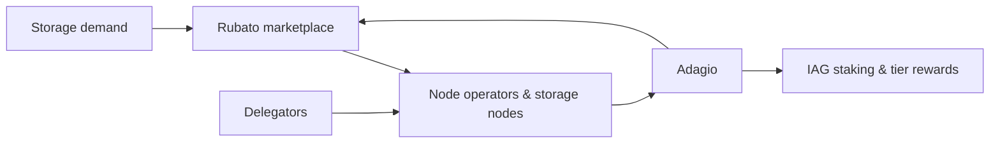
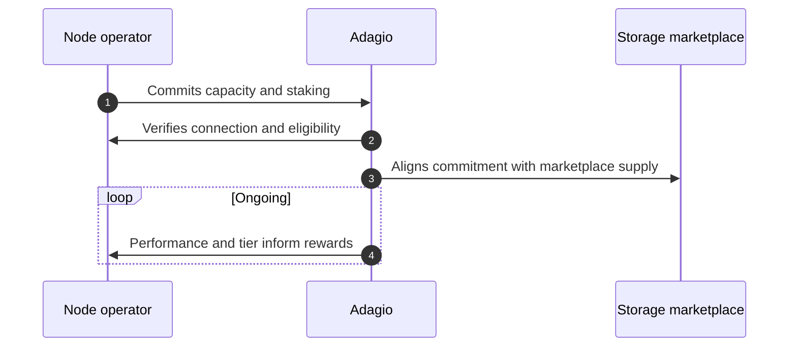

Detailed Storage Architecture
# Adagio

## Overview

Adagio is the part of the Iagon protocol that connects storage demand from consumers with supply from storage node operators. It sits alongside the storage marketplace ([Rubato](../high-level-architecture#rubato) in the high-level architecture) and the IAG staking and rewards system: when node operators commit capacity and lock IAG tokens to activate it, and when delegators delegate IAG to those nodes, Adagio-related flows align commitment, performance, and reward eligibility with how the network actually behaves in production.

Consumer payments (for example subscriptions paid in stablecoins or through on-chain flows) and provider economics are described in the broader protocol documentation; this page focuses on how Adagio fits with node operator commitment, delegators, tiers, and earnings as documented on the storage-node pages linked below.

How Adagio sits between demand, the marketplace, and node operators / delegators (high level):

## Node Operators, Delegators, and Commitment

- Node operators run storage nodes, commit how much capacity they serve, and stake IAG tokens so that economic weight matches activated storage and the current IAG price.
- Delegators delegate IAG tokens to nodes they trust, based on their performance history and node tier, increasing the node’s total stake and activating more storage on the network without operating hardware themselves.

Staking scales with committed storage and IAG price, and uses a three-month unbonding path when operators or delegators exit so that capacity and data availability are not disrupted abruptly. Full formulas, schedules, and behaviours are documented in [IAG Staking](../../provide-resources/storage-nodes/iag-staking).

## Performance, Tiers, and Tier Score

Rewards are not a flat handout: the network measures how each node performs (storage throughput, internet bandwidth & latency, uptime and other stats) and assigns a tier from 0 to 10. Tier 0 means the node does not earn rewards for that period; higher tiers unlock a share of the reward pools. Committed storage is evaluated together with performance so that tier placement reflects credible capacity, not only a large pledge.

Within each reward-eligible tier, a Tier Score (1–100) describes how well the node performs relative to other nodes in the same tier, together with stake, when splitting that tier’s allocation. Details, thresholds, and the Tier Score concept are in [Tier System](../../provide-resources/storage-nodes/tier-system).

## IAG Staking Rewards and Fees

IAG staking rewards come from a 15-year emissions schedule, distributed by epoch, allocated across tiers using tier factors, then to nodes in proportion to performance-related weight and stake, with per-tier APY caps and overflow to lower tiers so no single tier captures too much of the pool. Rewards are calculated for each epoch and become claimable after 73 epochs; node operators and delegators participate according to the rules in [IAG Staking](../../provide-resources/storage-nodes/iag-staking) (including yearly allocations, epoch pots, tier factors, caps, and overflow).

Separately from emissions-based IAG rewards, consumers pay for storage through subscriptions. The [Fees](../../provide-resources/storage-nodes/fees) page describes how those fees are allocated: 90% of the total collected from storage subscribers goes to node operators and delegators, proportional to the storage staked for each node. The remainder covers treasury, buyback, and other uses explained on that page.

## How Adagio Fits in the Flow

The sequence below is a schematic: exact steps and on-chain artifacts may match your deployment, but the roles (node operator, Adagio, marketplace) stay the same at a high level.

In practice, performance inputs for tiers draw on network-wide observation of how storage nodes behave (for example uptime and throughput), not from Adagio in isolation. The [high-level architecture](../high-level-architecture) summarizes how those signals support ranking, sharding, and operations across the fleet.

## Bad Actors and Fair Play

Node operators are expected to meet performance and honesty expectations. Nodes that fall into Tier 0 or attempt to abuse the system do not receive rewards for the affected periods; well-behaved node operators and their delegators earn according to the tier and staking rules in [IAG Staking](../../provide-resources/storage-nodes/iag-staking) and [The 10-Tier System](../../provide-resources/storage-nodes/tier-system).

 
