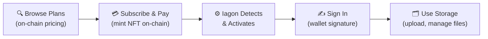
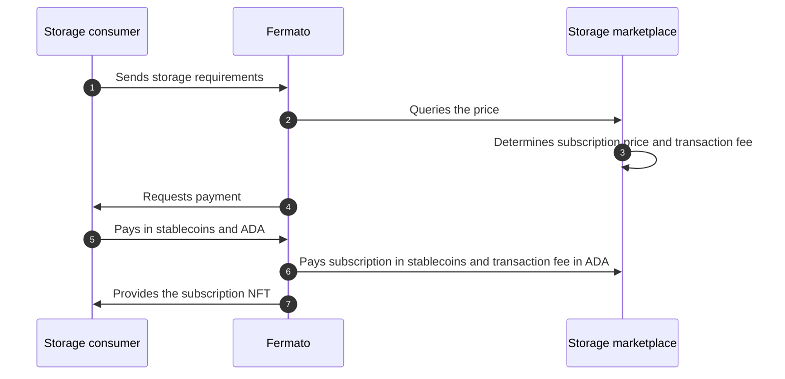
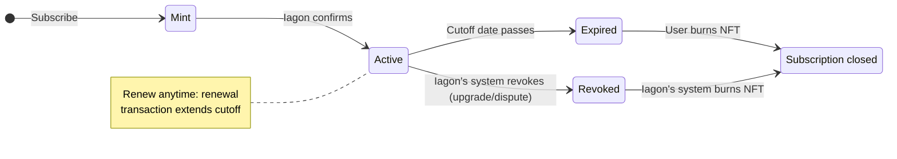
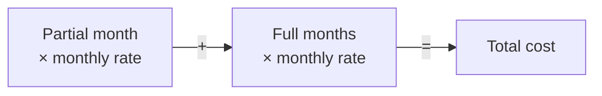
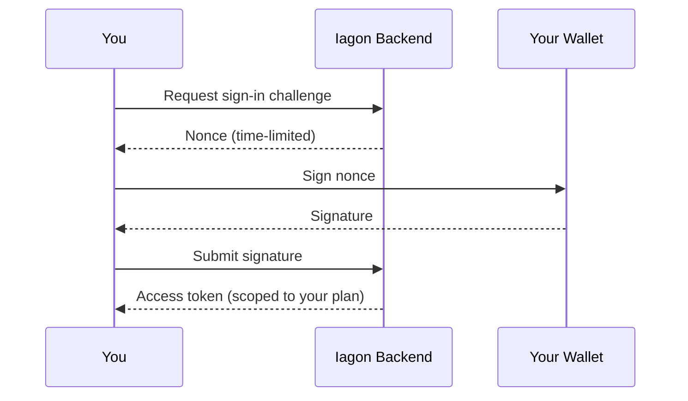

Detailed Storage Architecture
# Fermato

**Fermato** is Iagon’s subscription layer: the part of the stack that sits between storage consumers, the [Rubato](../high-level-architecture#rubato) marketplace, and Cardano smart contracts. Through Fermato you buy storage and manage subscription status on chain (pricing comes from the marketplace; settlement and the on-chain subscription record go through Fermato). This page describes that on-chain subscription path end to end. For Fermato in the wider protocol picture, see [High-level architecture](../high-level-architecture#fermato).

:::info
Fermato is under active development. The behaviour and interfaces described on this page reflect current intent but may change as the design and implementation settle.
:::

## Overview

:::tip On-Chain Subscriptions
These flows run through **Fermato**. The page explains on-chain subscription records on Cardano and how they interact with Iagon storage access. Product behaviour and parameters may vary by release; use this as architecture guidance and confirm details in the live product when needed.
:::

On-chain subscriptions record your Iagon storage subscription directly on the Cardano blockchain. Instead of your subscription simply living as a row in a centralized database, it exists as an NFT locked in a smart contract. Anyone can query the chain to verify that your subscription exists, what you paid for, when it expires, and what tier you're on.

You choose a storage plan, pay in ADA or stablecoin, and authenticate with a wallet signature. The Iagon backend monitors the chain and activates your subscription automatically.

This is an alternative to the existing website subscription flow. Both paths give you access to the same Iagon storage services.

Who may read, share, or change your files follows Iagon’s encrypted storage model in [Secure Lake](./secure-lake.md), alongside your subscription. Fermato focuses on payments and on-chain subscription state tied to your wallet, not file permissions.

 

:::tip Why On-Chain?

With a traditional subscription, the provider's database is the only record that you're a paying customer. If that database has an error, gets wiped, or the provider decides to change your terms - you have no independent proof of what you purchased.

On-chain subscriptions change this. Your subscription is a verifiable on-chain record tied to your wallet.

| | On-Chain Subscription | Traditional Subscription |
|---|---|---|
| **Subscription record** | On-chain NFT locked in the contract - publicly verifiable | Database entry - provider-controlled |
| **Proof of purchase** | Immutable transaction history | Receipt email (if you kept it) |
| **Transparency** | All terms visible in the NFT | Terms can change server-side |
| **Portability** | Tied to your wallet, not an account | Tied to a username/password on one platform |
| **Resilience** | Survives backend outages or data loss | Lost if the database fails |
| **Payment** | ADA or stablecoin, settled on-chain | Credit card / fiat gateway |
| **Authentication** | Wallet signature | Username & password |

:::

## How It Works

The steps below are what you see as a user; Fermato coordinates marketplace pricing, payments, and the transactions that mint or update your subscription NFT.

1. **Browse plans**: View available storage tiers and their prices, pulled directly from on-chain data. No authentication required.
2. **Subscribe**: Select a plan and duration, then sign a transaction that mints a subscription NFT and pays the cost. The NFT is locked in the subscription contract with your subscription details recorded in it.
3. **Activation**: The Iagon backend detects the new on-chain transaction and activates your subscription automatically.
4. **Sign in**: Prove wallet ownership through a challenge-response signature to receive an access token scoped to your plan.
5. **Use storage**: Start uploading and managing files through Iagon's storage API.

### Fermato: Purchase and Update

The sequence below is a simplified view of Fermato with the storage marketplace and your wallet when you purchase storage or update a subscription (not every edge case):

## Subscription Lifecycle

 

Each subscription has a cutoff date - always set to the 1st of a month. When the cutoff passes, the subscription expires and Iagon marks it inactive. You can renew at any time to extend the cutoff, or let it lapse and burn the expired NFT to reclaim the UTxO.

Renewal keeps the same subscription NFT and updates it (for example cutoff and payment). That is not the same as [Upgrading Your Plan](#upgrading-your-plan), which triggers a new mint for the new tier plus a Revoke (burn) of the old NFT by Iagon's system. See [Renewal](#renewal) for how renewal differs from first-time subscribe and from tier changes.

## What's Stored On-Chain

Your subscription NFT contains everything that defines your subscription:

| Term | Description |
|-------|-------------|
| **Subscriber** | Your public key hash |
| **NFT pointer** | Identifies the specific subscription NFT |
| **Plan ID** | The storage tier you subscribed to |
| **Cutoff date** | When the subscription expires (1st of a month) |

 

This is all publicly verifiable. Anyone can query the contract and confirm that a subscription exists, what plan it covers, and when it expires - without relying on Iagon's backend.

## Plans & Pricing

Fermato uses this on-chain plan data when determining what you pay for a given tier and duration.

Storage plans are stored on-chain, mapping each plan to a monthly cost in lovelace. You can view available plans and pricing without any authentication - it's a read-only on-chain query.

An off-chain registry maps plan IDs to human-readable descriptions (e.g. "500 GB").

Prices are denominated in ADA. If you prefer to pay with a stablecoin, the Charli3 oracle price feed provides the conversion rate at the time of your transaction.

 

:::info Future Pricing Option
A model under consideration would define plan prices in USD (e.g. $2.20/month for 500 GB). In this case, the oracle would convert the USD amount to ADA at payment time, and stablecoin payments would map directly to the USD price without needing conversion.
:::

## Subscribing

When you subscribe, the following happens in a single transaction:

1. The transaction is read for plan pricing.
2. The oracle UTxO is referenced for the current month period.
3. A subscription NFT is minted and locked in the subscription contract.
4. The cost is sent to the designated payment address.
5. You sign the transaction with your wallet.

### Pro-Rated Pricing

Your first partial month is pro-rated. If you subscribe partway through a month, you pay only for the remaining days in that month, plus the full rate for any additional months selected.

The partial month amount uses (days remaining ÷ total days in that month) against the monthly rate, as described above.

## Renewal

Renewal extends an existing subscription for the same storage tier. You sign a renewal transaction that updates the subscription NFT locked at the contract for your plan (for example a later cutoff date and the payment for the renewal). You do not mint a second subscription NFT for that tier, and you do not go through the revoke-and-replace flow used when changing plans.

**Renewal vs upgrade:** [Upgrading Your Plan](#upgrading-your-plan) is different: you subscribe to the new tier (minting a new NFT), Iagon's system revokes the old subscription (burning the old NFT). Use that path when moving to a higher tier - not when simply extending the same plan.

Depending on whether your subscription is still active or already lapsed:

- **Still active**: Your cutoff extends forward from the current cutoff.
- **Lapsed** (inactive; the subscription NFT is still locked at the contract and has not been burned): The cutoff is set from the current oracle period using the same pro-rating rules as in [Subscribing](#subscribing) - this describes pricing and dates, not the on-chain mint-and-revoke sequence used for upgrades.

Pro-rating applies to renewals the same way - the first partial month is based on the remaining days in the current period.

## Signing In

Iagon uses a challenge-response flow to verify that you own the wallet associated with a subscription.

 

1. You request a nonce from Iagon, bound to your wallet address.
2. You sign the nonce with your wallet.
3. You submit the signature back to Iagon.
4. Iagon verifies the signature, confirms your subscription is active, and returns an access token scoped to your plan.

The access token is used for all storage operations. When it expires, you repeat the signature flow to get a new one. This works with any wallet that supports the standard Cardano wallet connector (CIP-30).

## Expiry

When your subscription's cutoff date passes:

1. Iagon marks your subscription as inactive.
2. Your access token is revoked - storage endpoints deny further requests.
3. You can burn the expired NFT on-chain to reclaim the UTxO.

To reactivate without changing tier, use a renewal as in [Renewal](#renewal) - same NFT, just updated. To move to a higher tier instead, follow [Upgrading Your Plan](#upgrading-your-plan) (new mint, then Iagon's system revokes the old NFT).

## Upgrading Your Plan

Upgrading is not renewal. Renewing extends the same plan via an NFT update. Upgrading changes tier: you get a new subscription mint for the higher plan and the previous subscription is revoked (burned) by Iagon's system.

To move to a higher storage tier:

1. Subscribe to the new, higher-tier plan (minting a new NFT).
2. Iagon's system revokes the old subscription (burning the old NFT).

If both subscriptions briefly coexist during the transition, Iagon uses the higher tier. In edge cases, you can resolve through the website.

## Cancellation

To cancel an active subscription, submit a request through the Iagon website. On-chain revocation is handled by Iagon's system, which burns the NFT.

## Reliability

Because your subscription lives on-chain, the subscription's details are publicly auditable. The backend maintains a cache for fast lookups, but the on-chain NFT is always the source of truth.

- **Confirmation depth**: Subscriptions are activated after reaching a minimum confirmation depth (~3 blocks), reducing the risk of acting on rolled-back transactions.
- **Periodic resync**: A background job reconciles the backend database with the on-chain state, catching any events missed during downtime or network interruptions.
- **Nothing is lost**: Even if the backend temporarily goes down or misses a transaction, the resync picks it up. Your subscription is always recoverable from the chain.

## FAQ

### Do I need to create an Iagon account?

No. Your wallet address is your identity. There is no registration, username, or password.

### What can I pay with?

ADA directly, or a supported stablecoin. Stablecoin payments use the Charli3 oracle price feed to convert the ADA-denominated price at the time of your transaction.

### How do I know when my subscription is active?

After your transaction is confirmed on-chain, check the status endpoint. The status shows `pending` while Iagon is processing, then switches to `active` once confirmed.

### Can I renew before my subscription expires?

Yes. Renew at any time. If your subscription is still active, the cutoff extends from where it currently is. The first partial month of the renewal is pro-rated. That is renewal (same tier, NFT update) - not [Upgrading Your Plan](#upgrading-your-plan), which you use when switching to a higher tier.

### What happens when my subscription expires?

Iagon marks it inactive and revokes your access token. You can no longer access storage endpoints. You can burn the expired NFT on-chain to reclaim the UTxO, or renew to reactivate the same plan ([Renewal](#renewal)). To move to a higher tier, use [Upgrading Your Plan](#upgrading-your-plan) - that path mints a new NFT and Iagon's system revokes the old one.

### Can I have multiple subscriptions?

A single wallet can hold subscriptions to different plans. Iagon tracks each independently.

### What if Iagon's backend goes down - do I lose my subscription?

No. Your subscription is recorded on-chain. The backend database is just a cache. When the backend recovers, it reconciles with the chain and restores your subscription state automatically.

 
