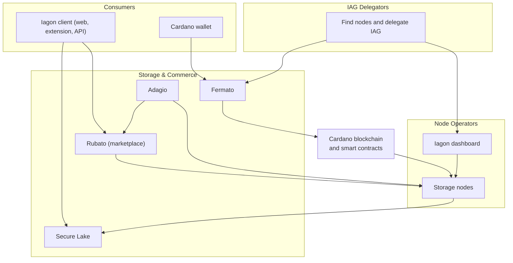

# High-Level Architecture

 

The architecture of the Iagon protocol consists of the following components:

## Iagon Client Application

Allows storage consumers to interact with the protocol. The client ships, or will ship, in the following forms:

  - Web application
  - Browser extension
  - Native clients for all major operating system platforms
  - Application Programming Interface (API)

## Secure Lake

At the heart of the consumer experience is Secure Lake, Iagon’s encrypted, resumable file storage and sharing layer. Files are encrypted on the client before upload; the network stores ciphertext and applies two complementary checks - who may reach a resource on the server, and who may decrypt it using per-recipient envelopes. That supports collaboration, sharing without re-encrypting large files for every new person, folders and drives with strong permissions (including groups, inheritance, and expiry), and headless or API-driven use. Where you subscribe or pay on Cardano, your wallet links identity and payment to the chain. Read more in [Secure Lake Technology](./detailed-storage-architecture/secure-lake.md).

## Cardano

Cardano is where Iagon’s on-chain storage economy runs: storage nodes register and commit capacity, node operators and delegators stake IAG tokens to align stake with pledged storage, and subscription or rewards flows that settle on-chain are recorded there. A Cardano wallet allows users to participate in the storage economy.

For consumers, the wallet supports authentication and payments tied to storage access and subscriptions. For node operators and delegators, it is the usual way to stake, delegate, and interact with the same chain state that anchors node participation and rewards. Details are in **[IAG Staking](../provide-resources/storage-nodes/iag-staking)**.

## Adagio

Implements a rewards model for storage providers and token delegators, connecting the demand of the consumers to the supply from the providers.

## Fermato

Fermato is the layer that connects storage consumers to Cardano smart contracts so they can subscribe to storage and manage subscription status. It queries the [Rubato](#rubato) marketplace for pricing, collects payment (stablecoins for the subscription and ADA for transaction fees), and produces the on-chain subscription record tied to the consumer’s wallet (for example a subscription NFT). Permissions over who may read, share, or change files live in [Secure Lake](./detailed-storage-architecture/secure-lake.md) next to the subscription; Fermato covers payments and on-chain subscription state. [Full Fermato documentation](./detailed-storage-architecture/fermato.md) covers the on-chain subscription flows in depth (NFT lifecycle, renewal, wallet sign-in, and related behaviour).

## Rubato

Is the storage marketplace that encodes the supply and demand for storage, allowing storage consumers to reserve and consume storage. It implements both a static pricing model for enterprise storage providers, and a dynamic one for retail nodes.

## Nodes

A **storage node** is a device operated by a node operator that joins the Iagon network and supplies the committed storage capacity to the network. Node operators install and run the **Iagon node application** on that device so the node can register, commit capacity, serve consumer data according to protocol rules, and stay reachable on the network.

Storage nodes are the physical supply side of the network: consumers buy subscriptions and store data against capacity that nodes have committed. The network continuously measures how each node behaves - uptime, throughput, and related signals - so the protocol can rank performance, rebalance shards, and run recovery and garbage collection fairly across the decentralized network.

Node operators manage their nodes through the Iagon dashboard - including verification, staking IAG tokens to activate the committed storage, monitoring status, and claiming earnings. Minimum hardware and eligibility expectations for running a node are described in [Minimum requirements for storage node eligibility](../provide-resources/storage-nodes/minimum-requirements).

## Iagon Dashboard

Storage providers use it to verify their nodes, stake IAG tokens for providing storage, view node information, and claim their earnings. IAG token holders can find nodes to support and delegate their tokens to back the node operators they choose.

The following diagram summarizes how the main pieces connect (not every data path is shown).

 
