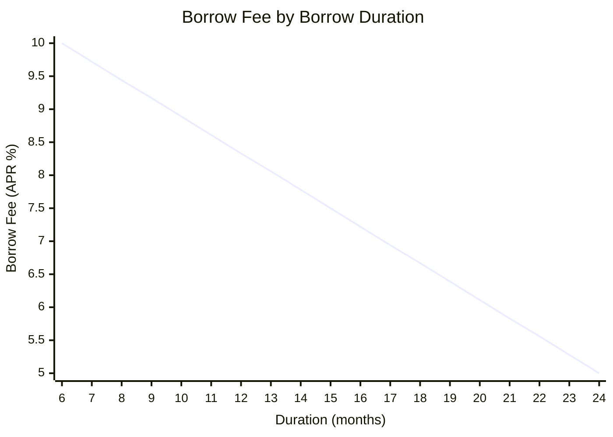
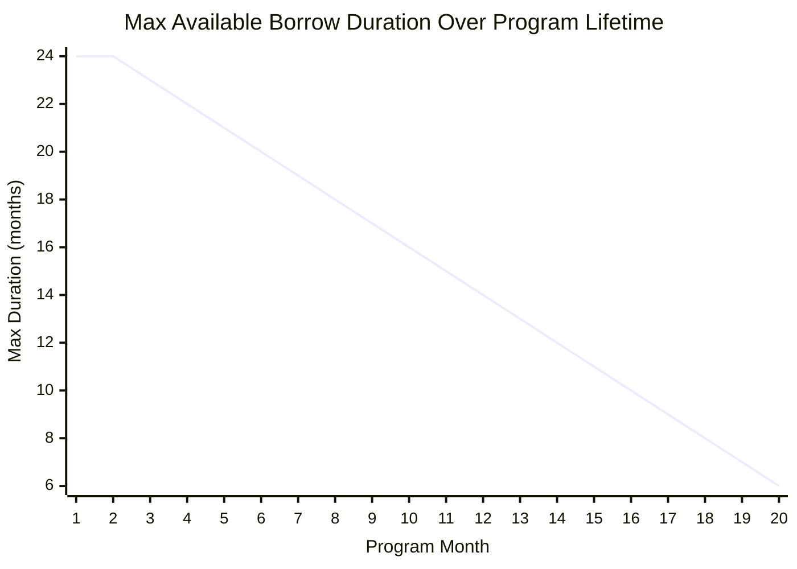
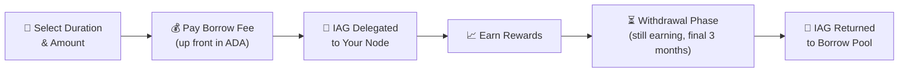

# Borrow Stake

## Overview

Borrow Stake is a program that enables delegated node operators to borrow IAG tokens and stake them to their node, earning 100% of the rewards generated by the borrowed delegation. Instead of sourcing delegators or purchasing tokens outright, node operators can borrow from a dedicated pool and put those tokens to work immediately - with a predictable cost structure and built-in yield.

This feature is available exclusively for **delegated nodes**. Independent nodes are not eligible.

 

:::tip Why Borrow Stake?

Traditional liquidity loans require borrowers to hunt for yield opportunities across DeFi protocols, exposing them to smart contract risk, impermanent loss, and market volatility - with no guarantee of positive returns.

**Borrow Stake flips the script.** Borrowed IAG tokens are immediately productive through Iagon's staking mechanism, generating both **IAG staking rewards** and a share of the network's **ADA revenue**. The yield isn't something you need to find - it's built into the protocol.

| | Borrow Stake | Traditional Liquidity Loan |
|---|---|---|
| **Yield source** | Built-in staking rewards + ADA revenue | Must be found by borrower |
| **Risk profile** | Predictable, protocol-backed returns | Smart contract risk, impermanent loss, market exposure |
| **Cost certainty** | Fixed rate, paid up front | Variable rates, ongoing payments |
| **Effort required** | None - rewards flow automatically | Active yield farming & management |

:::

## How It Works

1. **Choose your loan**: Select a Borrow Duration (6-24 whole months) and the amount of IAG you want to borrow from the pool (up to the maximum your node can accept).
2. **Pay the borrow fee up front**: Your Borrow Fee is calculated based on the ADA value of the borrowed IAG at current market rates, and is paid in ADA at the time the loan is built.
3. **Tokens are staked**: The borrowed IAG is delegated to your node with a **100% margin** applied. All delegation earnings from this position flow directly to you.
4. **Earn rewards**: You earn the position's share of IAG staking rewards and ADA fees from the borrowed stake - just like margin collected from regular delegators' earnings, but at 100% margin.
5. **Automatic withdrawal**: In the final 3 months of the loan term, the borrowed delegation automatically enters the standard withdrawal phase. Earnings continue as normal throughout this period. No action is required.
6. **Loan closes**: At the end of the term, the borrowed IAG tokens are automatically withdrawn to the borrow pool and made available to borrow again.

## Borrow Fees

Borrow Fees are expressed as an APR (annual percentage rate) and scale linearly between **5%** and **10%** based on the Borrow Duration. Longer commitments are rewarded with lower rates.

 

 

:::info Borrow Fee Formula
$$
\text{Borrow Fee (APR)} = 10\% - \left(\frac{\text{Duration} - 6}{18}\right) \times 5\%
$$

Where **Duration** is the selected Borrow Duration in months (6-24).
:::

### How Interest Is Calculated

The Borrow Fee is applied to the **ADA value** of the IAG being borrowed, not the IAG amount directly. At the time the loan is created:

1. The borrowed IAG amount is converted to its ADA equivalent at the current market rate.
2. The Borrow Fee rate is applied to this ADA value over the loan's duration.
3. The resulting interest amount is paid **up front in ADA**.

This means the borrower's total cost is known and locked in before the loan begins.

## Borrow Durations

Borrow Durations can be any whole number of months between **6 and 24 months**. Durations are locked in at the time the loan is created - **early exits are not possible** since interest is paid up front.

### Program Availability

The Borrow Stake program runs for a total of **25 months**. As the program progresses, the maximum available Borrow Duration is progressively clamped to ensure all loans complete within the program's remaining timeline:

- **Months 1-2:** Full range available - up to 24-month Borrow Durations
- **Month 3 onward:** Maximum duration decreases by 1 month for each program month elapsed
- **Month 20:** Final month to open a new loan (minimum 6-month duration)
- **Months 21-25:** No new loans - remaining time reserved for active loan completion

## Loan Lifecycle

The borrowed IAG generates rewards for your node for the **entire loan term** - including during the withdrawal phase - exactly as any other delegated stake would, except with a 100% margin, meaning you capture the full earnings from the position. Rewards and fees are earned to the node just like margin is collected from regular delegators' earnings.

:::warning
If a node retires during an active Borrow Stake loan, the borrowed stake immediately enters the withdrawal phase so that it is withdrawn back to the pool at the exact same time the node is fully retired (after 3 months). No Borrow Fee refund is offered if a node retires early.
:::

## Program Details

| Detail | Value |
|--------|-------|
| **Borrow Pool Size** | 10,000,000 IAG |
| **Token Source** | Unlocked Team allocation |
| **Program Duration** | 25 months |
| **Min Borrow Duration** | 6 months |
| **Max Borrow Duration** | 24 months |
| **Borrow Fee Range** | 5%-10% Borrow APR |
| **Interest Payment** | Up front, in ADA |
| **Margin on Borrowed Stake** | 100% |
| **Eligible Node Type** | Delegated nodes only |

 

The 10 million IAG borrow pool is sourced from the unlocked Team token allocation. Rather than selling these tokens on the open market or through OTC deals, Borrow Stake puts them to productive use - generating revenue for the project while simultaneously boosting node operators' staking capacity and strengthening the network.

## Definitions

### Borrow Fee

The interest rate applied to the loan, expressed as an APR (annual percentage rate). Ranges from 5% (24-month term) to 10% (6-month term), scaled linearly. The fee is calculated on the ADA value of the borrowed IAG and paid up front in ADA.

### Borrow Duration

The total length of the loan in whole months (6-24). This period includes both the active staking phase and the final 3-month withdrawal phase. Borrow Durations are locked in and cannot be shortened unless the node retires. If a node retires while borrowing stake, the borrowed stake immediately enters the withdrawal phase so that it is withdrawn back to the pool at the exact same time the node is fully retired (after 3 months). No borrow fee refund is offered if a node retires.

### Borrow Pool

A dedicated pool of 10,000,000 IAG tokens sourced from the unlocked Team allocation, made available for node operators to borrow through the Borrow Stake program. IAG tokens are returned to the pool and made available to be borrowed again after the completion of a loan.

## FAQ

### What happens if the IAG price changes significantly during my loan term?

Your Borrow Fee is locked in at the time the loan is created based on the ADA value of the borrowed IAG at that moment. Price movements after that point do not affect your interest payment - it's already been paid. However, the IAG staking rewards you earn are denominated in IAG, so the ADA value of those rewards will fluctuate with the market. The ADA network revenue share is earned directly in ADA and is unaffected by IAG price movements.

### Can I take out multiple loans at the same time?

Yes. A node operator can take multiple loans from the borrow pool, provided there are sufficient tokens available. Each loan is independent with its own Borrow Duration, Borrow Fee, and withdrawal timeline.

### What happens if the borrow pool runs out of tokens?

Loans are available on a first-come, first-served basis. If the full 10 million IAG pool has been allocated to active loans, no new loans can be created until existing loans mature and tokens are returned to the pool.

### Do I need to repay the borrowed IAG at the end of the term?

No manual repayment is required. The borrowed delegation automatically enters the withdrawal phase during the final 3 months of the loan term, and the IAG tokens are returned to the borrow pool when the term ends. The only payment you make is the up-front Borrow Fee in ADA.

### What happens if my node goes offline or loses reputation during the loan term?

The borrowed stake remains delegated to your node for the full Borrow Duration regardless of node performance. However, a node with lower uptime or reputation will earn fewer rewards, which directly reduces the return on your borrowed position. The Borrow Fee is non-refundable, so maintaining strong node performance is essential to making the loan beneficial.

### What happens if my node retires while I have an active loan?

If a node retires during an active Borrow Stake loan, the borrowed stake immediately enters the withdrawal phase so that it is withdrawn back to the pool at the exact same time the node is fully retired (after 3 months). No Borrow Fee refund is offered if a node retires early.

 
