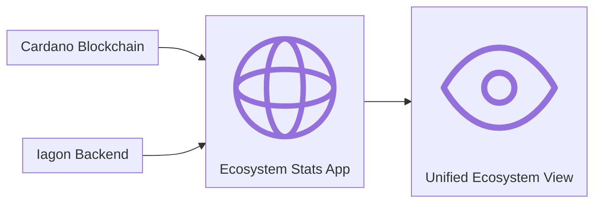

# Ecosystem Stats App

## Overview

**Ecosystem Stats** is a web app that brings Iagon's on-chain and network activity into one place. It tracks Iagon-related statistics across **Cardano** and the **Iagon network**, giving the community, node operators, and stakeholders a clear, up-to-date view of how the ecosystem is growing and performing.

Instead of piecing together numbers from separate dashboards, explorers, and internal tools, Ecosystem Stats surfaces the metrics that matter in a single, easy-to-read experience.

## What It Covers

At a high level, the app aggregates Iagon-related activity from two complementary layers:

- **On Cardano** - Public ledger data tied to Iagon, including token movement, staking, and other chain-visible activity that reflects how participants engage with the protocol.
- **On the Iagon network** - Operational and network-level statistics maintained by Iagon's backend, reflecting the live state of storage, nodes, and related ecosystem services.

Together, these sources provide a unified snapshot and historical tracking of ecosystem health, participation, and growth over time.

## Data Sources

Ecosystem Stats is built on two authoritative data layers:

| Source | Role |
|---|---|
| **Cardano Blockchain** | On-chain records for Iagon-related assets, staking, and other public ledger activity. |
| **Iagon Backend** | Network and platform statistics that reflect the current state of Iagon services and infrastructure. |

Data from both sources is combined in the app so metrics stay aligned with what is verifiable on-chain and what reflects real-time network operations.

## How It Works

1. **Collect** - On-chain data is read from Cardano; network statistics are sourced from Iagon's backend services.
2. **Combine** - Related metrics are brought together so on-chain and off-chain signals tell a coherent story.
3. **Present** - The app displays an at-a-glance view of Iagon ecosystem activity, updated from these live sources.

 
