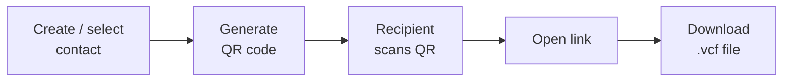

# Kliq Contact App

## Overview

Kliq, a web app, is designed to facilitate seamless user registration, personal contact information (profile) management, and contact management, including QR code-based contact information sharing. This app will also contribute to the Contacts module in our upcoming Volo chat dApp.

## Objectives
1. Provide a platform for users to register and manage their profiles.
2. Enable users to create and manage contacts.
3. Allow users to share contact information via QR codes.
4. Demonstrate the use of Iagon's storage and application deployment capabilities.

## Key Features

### User Registration and Authentication
1. Registration: Users can sign up using their email, providing a username, email and password.
2. Login: Users login using their email.
3. Password Reset: Users can reset their forgotten password.

### Personal information update
1. Personal Contact Information Update: Users can update their profile information, including name, contact info, social media accounts and a profile icon.

### Contact Management
1. Contact Form: Users can create and manage contacts by filling out a form that supports all fields in a .vcf file (e.g., name, phone number, email, address).
2. Contact Sharing via QR Code:
- Each contact can be shared using a unique QR code.
- Users can create groups of contacts and share a QR code for the entire group.
- Scanning the QR code redirects the recipient to a link to download the .vcf file.

### Storage and Hosting
1. The image files will be stored in Iagon storage.
2. The app will be hosted on the Compute dApp platform 

## Alpha Release Scope

### User Registration
- Implement user sign-up, login, and password reset functionalities.

### Personal Information Management
- Enable users to edit their personal contact information.

### Contact Management
- Implement a contact form supporting all .vcf fields.
- Enable QR code generation for individual contacts.
- Allow users to edit contact information.

## Technical Requirements
- Frontend Technologies: Progressive Web App (PWA) framework (Next.js)
- Backend Technologies: Nest.js
- Database: MongoDB
- Storage: Iagon Storage for storing profile images.
- Hosting: Iagon's Compute dApp platform for app deployment.

## Future Enhancements

### Group Contact Management
- Allow users to create and manage groups of contacts. Enable QR code generation for groups of contacts.

### Import .vcf Files
- Enable users to import .vcf files to directly load contact information into the app.

### Advanced Sharing Options
- Add functionality for sharing contacts via email, social media, and other platforms.

### Improved User Interface
- Enhance the UI/UX of the profile and contact management sections.

### Analytics and Reporting
- Implement analytics to track user engagement and app usage.

### Integration with Other Services
- Integrate with third-party services for enhanced functionality (e.g., social media integration, calendar syncing). 
- Sync contacts with phone and other relevant apps; manage conflicts for merging or deleting.
- Restore contact features
- Registration process enhancement - Web 3.0 support and oAuth integration

 
