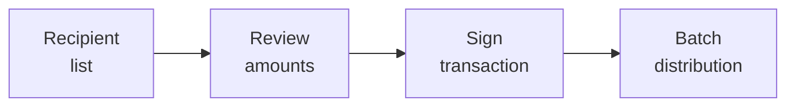
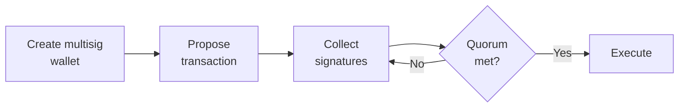

# LedgerFlow

## Overview

:::tip The New LedgerFlow is Coming Soon
LedgerFlow is receiving a feature overhaul and the all-new version is coming soon.
:::

**LedgerFlow** is an innovative project that operates within the **Cardano blockchain** ecosystem. It offers two essential features: **Multisender** and **Multisignature (Multisig)** capabilities. Let's delve into each of these functionalities:

## Multisender

   - The **Multisender** feature enables users to efficiently send **multiple assets** to **multiple recipients** simultaneously. Whether you're distributing payments, rewards, or other digital assets, this functionality streamlines the process.
   - By leveraging **Multisender**, organizations, businesses, and individuals can disburse funds to a group of recipients without the need for individual transactions. This not only saves time but also reduces transaction fees.
   - Imagine a scenario where a company wants to distribute bonuses to its employees or a decentralized application (DApp) needs to reward its users. **Multisender** simplifies such tasks by allowing batch transfers.

## Key features of Multisender

1. **Batch Transactions**

   - **Multisender** allows you to send tokens to **multiple recipients** in a single transaction.
   - Whether you're distributing rewards, payments, or other assets, this feature streamlines the process.
   - Instead of handling individual transactions, you can efficiently manage bulk transfers.

2. **Reduced Transaction Fees**

   - With **Multisender**, you save significantly on transaction fees.
   - Rather than incurring fees for each individual transfer, batching transactions reduces the overall cost.
   - This cost-effectiveness benefits both users and organizations.

3. **Address Book Management**

   - LedgerFlow's updated **multisender app** introduces **Address Book management**.
   - You can maintain a list of recipients, making it easy to select and send tokens to specific addresses.

4. **Labels Management**
   - **Labels management** enhances usability.
   - Assign labels or tags to recipients, improving organization and tracking.

## Multisignature (Multisig)
   - **Multisig** is a powerful security feature that enhances the safety of cryptocurrency wallets and transactions.
   - In a **Multisig** setup, multiple parties (often referred to as signatories) collaboratively manage a wallet. Transactions require approval from a predefined number of these signatories.
   - For instance, a company treasury might use a **Multisig** wallet where three out of five board members must sign off on any outgoing transaction. This prevents unauthorized access and provides redundancy.

## Key features of Multisignature

1. **Basic Contract**

The basic contract is designed with a multisig contract and a threshold quorum of predefined wallet addresses. Its core functionality includes:
- Adding and withdrawing ADA and digital assets.
- Utilizing a signature flow for transaction validation, requiring m-out-of-n signatures for transaction approval and submission.

2. **Editable Contract**

The editable contract facilitates dynamic changes as organizational needs evolve. It:
- Develops reference inputs allowing for timely contract updates.
- Supports adding/removing wallet addresses.
- Allows for updating the threshold quorum, effectively adjusting the m in the m-out-of-n scheme.

3. **Contract Testing**

Our offering ensures robustness and security through rigorous testing:
- Automated unit and integration tests for contract logic.
- Thorough security testing.

4. **Deployment Module**

The deployment module enables customization for different organizational contracts:
- Contracts can be parameterized for deployment using the template contract.

5. **Security & Privacy**

- All smart contracts are meticulously tested against known attacks and vulnerabilities.
- No private key or key material is included in the contract, ensuring optimal security.

6. **Notable Considerations**

- Depositing ADA, NFTs, or digital assets directly to the smart contract address must be done using the correct datum. Failing to do so may result in non-recoverable assets.
- Scheduled or automatic asset transfers are not achievable without an external trigger.

## Additional Services

### Wallet Integration

We can assist with wallet connectivity and complex transaction building for seamless interaction with the contract.

### Transaction History

We can provide an API for transaction history retrieval. This off-chain solution is more cost-effective and allows for easy frontend integration.

## How does this LedgerFlow multisignature work?

### Create a multisig wallet

#### Steps for creating multisig wallet

- Setup multisig user accounts - In the first step, all users and a number of required signatures are passed to create the proposal. After a user creates a proposal all the users have to sign and generate the public key and public key hash and store it for future transactions.

- Fetch the contract details - After collecting all the public key and public key hash, the contract is fetched from the Multisig-Server API. The main fund UTXO ID is used to create the Proposal Contract, Quorum Contract and the Vault Contract along with their respective addresses.

- Deploy the contract by minting proposal tokens/quorum NFT and send it to contract if not already done - Token Proposal is used for storing the state in the contract. We mint this token using our minting script and send it to our contract for deployment.

In the first mint, we mint multiple proposal tokens, but only a single quorum NFT.
Utxo ID of deployer having funds is used to create a unique policy id for minting contract.
Compile the output transaction from the following code as user A in transaction builder, sign, submit the transaction and obtain the transaction hash.

### Off-Chain Withdraw

#### Steps for Off-chain Withdrawal

- Offchain signature collection - Any users from multisig wallet can create a withdrawal transaction. First, the user will create a message with the withdrawal address and the amount to withdraw. That user signs the message and stores it in the database. Other users also add signatures for created messages.

- Withdrawing from vault using collected signatures - Obtain the receiver's stake key hash and public key hash using the address utility and decompose the address and send it to the receiver's address to obtain the stake key hash and public key hash.

### On-Chain Withdraw

#### Steps for On-Chain withdrawal

- Create a proposal cn-chain - Any users from multisig wallet can create a withdrawal transaction. First, the user will create a proposal with the withdrawal address and the amount to withdraw. That user submits the proposal and stores the transaction hash. Other users also add signatures for created proposal transaction hash. This signature will be used in composing the offchain signature transaction.

- Other users sign the proposal on-chain - Unlike off-chain transactions, in on-chain withdrawal transactions are written in blockchain instead of signing a message.

- Withdraw the proposed amount from the proposal to the intended receiver on-chain - Anybody can withdraw the amount from the proposal. The withdrawal will only transfer the proposed amount from the vault to the intended receiver. Any changes to the withdrawal amount or other parameters fails the transaction as intended. The user withdrawing is only paying for the transaction fees and cannot make any other changes to the transaction.

### Off-Chain Update Parameters

#### Steps for Off-Chain Update Parameters

This step is used to change the participants of the multi-sig wallet or change the number of required signatures to create a transaction.

- Obtaining the message hash for signature - Anyone can collect the signature off-chain. First, you will need to obtain the message hash and sign it to obtain the message and signature. This signature will be used in composing the offchain signature transaction.

- Collect the signatures from participants wallets - All participants of the multisig need to sign the transaction in order to proceed.

- Compose transaction for updating the quorum OffChain - A transaction is created and submitted to update the quorum and the data is to be updated.

### On-Chain Update Parameters

#### Steps for On-Chain Update Parameters

This step is used to change the participants of the multi-sig wallet or change the number of required signatures to create a transaction.

- Create a proposal to update the quorum - This follows the same steps as on-chain withdrawal. A user creates a proposal with required signature, public key and public key hash. Then submit the proposal and store the transaction hash in the database.

- Other users sign the proposal on-chain - After that step other users add the signature to the proposal using the transaction hash of the proposal transaction.

- Update the proposed signatories and required threshold from the signed proposal - Then, final transaction to update quorum using the user's added signature transaction hash and new parameters.

 
