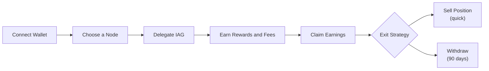
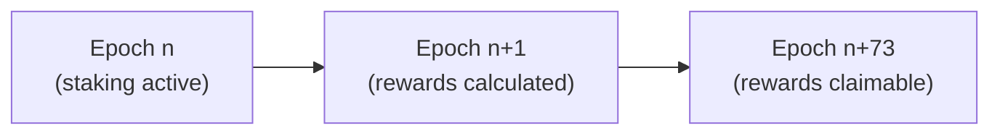
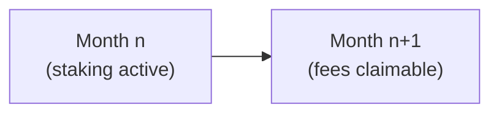

# Staking Platform

## Overview

The Staking Platform is a platform where IAG token holders can participate in the Iagon network by delegating their tokens to nodes, contributing to their total stake in exchange for a share of the node's earnings. The Staking Platform interacts directly with the blockchain indexer to offer real-time updates on storage stake and delegation.

From a user's perspective, the Staking Platform is a closed ecosystem as it interacts directly only with the [Adagio](/iagon-storage/detailed-storage-architecture/adagio.md) protocol and [Fermato](/iagon-storage/detailed-storage-architecture/fermato.md).

Delegated staking works similar to node staking and is subject to the same 3 month withdrawal period. Delegated staking positions can also be liquidated by their owner at any time on the Staking Platform's Market. The buyer of a delegated position from the Market earns any future earnings for that position, and the seller keeps their accumulated earnings. You may move your IAG delegation to a new node at any time if you're not satisfied with a node's performance or earnings.

 

:::info
Staking IAG tokens involves lockup times and vested rewards claims. Please ensure that you fully understand these timelines before participating. 
**Withdrawing delegated tokens:** 90 days from time of withdrawal initiation. 
**Staking rewards claims:** Staking Rewards for epoch `n` are calculated at epoch `n+1` but distributed at epoch `n+73`. Rewards can be claimed as they are available.
:::

 

:::tip Why Delegate Your Stake?

| | Delegated Staking | Holding Idle Tokens |
|---|---|---|
| **Earning potential** | Earn a share of node earnings (IAG rewards + ADA revenue) | None - tokens sit idle |
| **Network contribution** | Strengthens node capacity and network security | No contribution to the network |
| **Liquidity** | Sell your position quickly on the Market, or withdraw after 90 days | Fully liquid at all times |
| **Effort required** | Minimal - delegate and keep an eye on node performance, move nodes instantly if necessary | None |

:::

## How It Works

1. **Connect your wallet**: Visit the [Staking Platform](https://dashboard.iagon.com/stake) and log in with your Cardano wallet.
2. **Choose a node**: Browse available delegated nodes and pick one based on margin, reputation, and availability.
3. **Delegate IAG tokens**: Stake your IAG tokens to a node. Your delegation increases the node's total stake and storage commitment.
4. **Earn IAG staking rewards and ADA**: Receive your share of the node's earnings each epoch, minus the node operator's margin.
5. **Claim Earnings**: Claim earnings as they're released - ADA fees monthly; IAG rewards after [unlock](#staking-rewards-timeline).
6. **Withdraw or sell your position**: Sell your position quickly on the Market, or initiate a withdrawal (90-day waiting period).

 

### Staking Rewards Timeline

Staking rewards are not available immediately. They follow a delayed distribution schedule tied to the epoch cycle.

### Fee Earning Timeline

Storage users pay their subscriptions in ADA. 90% of those fees are distributed amongst node participants, including IAG token delegators.

## Getting Started

### Stake your IAG tokens
IAG token holders who don't want to run their own node can delegate their IAG tokens to existing nodes to earn a share of the node's earnings.
- Visit the [Staking Platform](https://dashboard.iagon.com/stake) and log in with your Cardano wallet.
- For a **quick and easy** experience, select the `Quick Delegate` page from the navigation bar on the left.
    - With the `Delegate` option selected, input the amount of IAG tokens you want to delegate, optionally set your preferred filters, and then select `Find Nodes`.
    - The best available nodes will be automatically selected based on your delegation amount, sorted by lowest node margin to highest.
    - You can select `Repeat Search` and modify your search filters or IAG token amount.
    - Once you've found a node or nodes that you're happy with, select `Delegate` to delegate your IAG tokens to the selected node(s).
- For a **more curated** experience, select the `Market` page from the navigation bar on the left.
    - Select the `Nodes` tab.
    - Use the filters to find the node that best suits your preferences.
    - Select `Delegate` to delegate your IAG tokens to the selected node.
    - You may delegate to multiple nodes if your top pick doesn't have enough storage availability for your token amount.

### Buy IAG tokens that are already staked
ADA holders who don't want to run their own node can buy IAG tokens that are already delegated to a node and earn a share of the node's earnings.
- Visit the [Staking Platform](https://dashboard.iagon.com/stake) and log in with your Cardano wallet.
- For a **quick and easy** experience, select the `Quick Delegate` page from the navigation bar on the left.
    - With the `Swap` option selected, input the amount of ADA you want to swap for IAG tokens, optionally set your preferred filters, and then select `Find Positions`.
    - The best available positions will be automatically selected based on your swap amount, sorted by lowest node margin to highest.
    - You can select `Repeat Search` and modify your search filters or ADA amount.
    - Once you've found a position or positions that you're happy with, select `Swap` to swap your ADA for IAG tokens that are already delegated.
    - You will receive all future earnings from the position(s) you now own.
- For a **more curated** experience, select the `Market` page from the navigation bar on the left.
    - Select the `Positions` tab.
    - Use the filters to find the position that best suits your preferences.
    - Select `Accept` to buy the position.
    - You may buy as many positions as you like.
    - You will receive all future earnings from any positions you buy.

### Move delegation to a different node
If you'd like to move your delegation to a different node, this can be done instantly without any waiting period.
- Visit the `More Details` page of the node you'd like to move your delegation to.
- Select `Move Delegation`.
- Select the existing position you'd like to move.
- Define how much of the existing position you'd like to move.
- Select `Sign Transaction` and sign the transaction to complete the move.

### Withdraw a delegated position
You may initiate the withdrawal process at any time.
- Visit `My Positions`.
- Select `Manage` on the position you'd like to withdraw.
- Select `Withdraw`.
- After reading and understanding the prompt, select `Yes, Withdraw`.
- Return to this position 90 days later to complete the withdrawal.

## Definitions

### Reputation Score

The Reputation Score is a rating from 0 to 72 calculated based on the node's performance and uptime history. This score impacts the node's earnings.

### Margin

The Margin is the percentage of the delegator's earnings pool that the node operator receives as a service fee, in addition to the node operator's own earnings. Updating a node's margin takes 2 epochs (10 days) to take effect.

### Return on Delegation (ROD)

Return on Delegation is a metric that shows the percentage of rewards return on a delegator's token delegation in a delegated position, similar to the widely used Return on Investment (ROI) metric.

### Quick Delegate

#### Delegate
The Quick Delegate feature allows token holders to delegate their tokens to a node quickly and easily by optionally selecting a few simple filtering and sorting parameters and being matched with the most suitable node or nodes based on the amount of tokens they want to delegate and the parameters they selected.

#### Swap
The Swap feature allows users to quickly and easily purchase the best available delegated staking positions listed on the Market.

### Sell a Delegated Position

The Sell feature allows the owner of a delegated staking position to list their position for sale on the Market. The position is then matched with a buyer and the transaction is executed by an orderbook batcher. This feature allows delegated positions to be liquidated quickly, avoiding the 3 month withdrawal period. Any accumulated earnings still belong to the seller, and any future earnings will go to the buyer.

### Increase Delegation

The Increase Delegation feature allows users to increase the amount of tokens they have delegated to a node they're already delegating to. This is done by adding more tokens to the existing delegated position, and requires the node to have the resources to accommodate the additional stake.

### Withdraw Delegated IAG

The Withdraw feature allows users to withdraw their IAG tokens from a delegated position. This requires a 3 month waiting period, during which the node's commitment will be reduced and data/tasks may be moved to other nodes. After the 3 month period, the IAG tokens will be withdrawable from the Staking Platform.

### Launching a Delegated Node

Node operators can selected Delegated Node as an option while launching a new node, or can convert an existing node to a Delegated Node by selecting the option on the node's details page. The latter option effectively resizes the node, committing more resources to the network, and making those additional resources available for delegation.

## Known Bugs

### Selling Delegated Positions With Lace Wallet

Lace Wallet does not read [enterprise addresses](https://docs.cardano.org/about-cardano/learn/cardano-addresses#enterprise-addresses) and does not allow spending from them. We recommend using a different wallet when interacting with dApps until this is fixed. If you do use Lace and you have listed and sold delegated IAG tokens on Iagon's Staking [Market](https://dashboard.iagon.com/stake/market/positions), your funds are 100% safe. After importing your seed phrase to a different wallet you'll see the ADA received in your transaction history and you'll have no issues spending the received ADA.

For detailed context, when delegated IAG tokens are sold on Iagon's Staking [Market](https://dashboard.iagon.com/stake/market/positions), the ADA is received by the seller's [enterprise address](https://docs.cardano.org/about-cardano/learn/cardano-addresses#enterprise-addresses) which saves some transaction fees. Although the ADA isn't linked to the seller's [stake address](https://docs.cardano.org/about-cardano/learn/cardano-addresses#reward-account-addresses), it is still fully spendable by the seller and most Cardano wallets display the incoming transaction and the balance the same way it would if their [base address](https://docs.cardano.org/about-cardano/learn/cardano-addresses#base-addresses) was used.

## FAQ

### Can I delegate to multiple nodes?

Yes. You can split your IAG tokens across multiple nodes. This is useful if a single node doesn't have enough storage availability to accommodate your full delegation amount, or if you want to diversify across operators.

### What happens if my node goes offline?

Your delegation remains in place, but rewards will decrease based on the node's performance. A node with lower uptime earns a lower Reputation Score, which directly reduces the earnings distributed to its delegators.

### How is my Return on Delegation (ROD) calculated?

Return on Delegation is the percentage return on your delegated tokens based on the node's earnings and the node operator's margin. It reflects how much you've earned relative to the amount you delegated, similar to a traditional ROI metric.

### Can I change nodes without withdrawing?

Yes. You can move your delegation to a different node instantly without any waiting period. Visit the new node's details page, select Move Delegation, and choose the position you'd like to move.

### What happens to my accumulated rewards if I sell my position?

You keep all accumulated rewards when you sell your position on the Market. The buyer receives the delegated position and earns all future rewards from that point forward.

 
