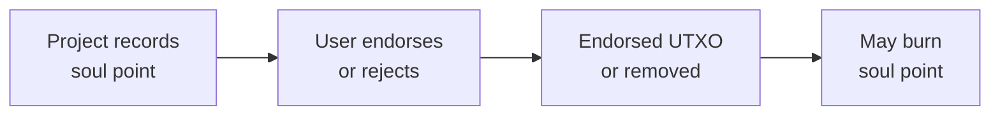
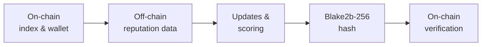

# Statur

## Overview

This documentation offers a comprehensive overview of Statur, also known as the Self-Sovereign Pseudonymous Reputational Model, and its components, which include Non-Transferable (Soulbound) Tokens and Dynamic Content NFTs.

The self-sovereign pseudonymous reputational model is a revolutionary solution that allows projects to gather, utilize, and disseminate information about their pseudonymous users, while preserving user data sovereignty. This concept employs two cutting-edge technologies: non-transferable (soulbound) tokens and dynamic content NFTs.

## Non-Transferable (Soulbound) Tokens

Soulbound tokens are unique assets whose non-transferability is enforced by the validator logic of the reputation contract. Cardano does not have a protocol-level mechanism to prevent token transfers; instead, the reputation contract simply has no spend path that allows the token to leave the contract address. The token is minted directly to the contract address - never to a user's wallet - and the only way to remove it is to burn it. The contract records the user's wallet address alongside the token, so a user's reputation can always be looked up from their wallet. Because the user never holds the token themselves, there is no token in their wallet for them to send to someone else.

These tokens facilitate the recording of a "soul point" within the reputation contract, which a user can either endorse or reject.

### Soulbound Token Flow

1. A Cardano-based project records a soul point within the reputation contract, linked to a user’s on-chain identity.
2. A “basic” soul point is stored on-chain as a UTxO at the contract address containing pertinent data.
3. The user can endorse the basic soul point or reject it.
4. If the user opts to discard the soul point, the UTxO is consumed and the token is burned. The transaction history remains on the blockchain permanently (as is true of all Cardano transactions), but the active reputation anchor is removed and the underlying reputation data cannot be reconstructed from the on-chain hashes alone.
5. If the user accepts the soul point, it is assigned a new “endorsed” signature.
6. The user retains the ability to reconsider at any moment and burn the soul point.

## Dynamic Content NFTs

NFTs are typically used to hold unique, static information on-chain. However, the capacity to dynamically update this data off-chain, without compromising the essential decentralization aspect, is highly desirable.

With our unique decentralized data storage network, an NFT can serve as a pointer to a file. The contents of this file are subject to change by users who hold certain access rights on the storage network.

## Reputational Model

By integrating the eUTXO model with our decentralized storage mechanisms, we can accumulate reputational information about a user's wallet and store it on our decentralized storage network. The on-chain file index tied to a user's wallet functions as a pointer to data that projects can dynamically update with information regarding the user's participation and behavior.

### End-to-End Reputation Flow

#### General Overview

The reputation contract system offers a straightforward yet effective mechanism for providing on-chain, verifiable reputation data. Users join the reputation system by entering into the smart contracts. A user's reputation data is then updated in real time using an off-chain database. Every user's on-chain data is periodically updated automatically using the off-chain data.

The goal of the system is to provide users with a cost-efficient and scalable method for storing and updating their reputation data. We opt for constant-cost and highly parallelizable smart contracts over variable costs and rigid solutions, resulting in a unique blend of on-chain and off-chain protocols. The final product is a system for storing reputations on-chain while updating them in real-time via an off-chain database.

### Entering the Reputation Contract

Each user will have a single UTxO inside the reputation contract, holding a special and soulbound NFT. The token may not leave the contract due to validator logic. A user may remove their UTxO from the reputation contract at any time; however, this will result in the burning of the soulbound token. The token serves as a unique identifier of a user's reputation, which is stored on-chain as a hash in the datum. The full reputation data is maintained in an off-chain database to support large data structures.

The soulbound token, the datum (containing the user's identity and reputation hash), and the ADA value all live together inside a single UTxO at the contract address. This is what ties a user's on-chain identity to their reputation state - the token acts as a thread that follows the UTxO through every update, ensuring continuity across transactions. This is a well-established design pattern in Cardano smart contract development.

Users will contribute Lovelace to a fee contract for periodic updates. A special batcher uses the off-chain database and fee contract to perform reputation updates efficiently through transaction chaining.

### Updating a User's Reputation

Reputation data is stored in an off-chain database. Storing complex data on-chain is limited by blockchain protocol constraints, so we only store a hash on-chain. Updates involve changing the hash of the off-chain data structure in a verifiable and reproducible way. These updates are efficient and allow for batch transactions. Users may also trigger updates independently if desired.

### Off-Chain Reputation Database

The off-chain reputation database operates as an account-based state machine. Each update (or transition) to a user's reputation is signed by an authorized party and stored in a linear history. This ensures full traceability and allows users to reproduce and verify their reputation state independently.

Users can selectively authorize projects to update their data. For example, a user in the Iagon ecosystem may allow Iagon to track and update their data. Other projects cannot update a user's reputation without explicit permission. Thus, reputation is user-centric and ecosystem-specific.

The on-chain reputation data is stored as a `Blake2b-256` hash of the canonical form of the user's reputation data. This allows for on-chain verification of off-chain data by reconstructing the hash step by step.

### Reputation Scoring

A user's reputation score in a project is a weighted average of their metric values for that project. Each metric a project defines has a weight that controls how much it influences the score: a higher weight means that metric counts for more, a weight of zero means it does not count at all (but is still tracked).

In short: multiply each metric's value by its weight, add those products together, then divide by the sum of the weights.

#### Example

Suppose a project tracks three metrics for a user, each with a weight chosen by the project:

| Metric          | Weight | Value |
|:----------------|-------:|------:|
| participation   |    3.0 |  0.95 |
| quality         |    1.0 |  0.80 |
| responsiveness  |    1.0 |  0.70 |

The score is `(0.95 × 3 + 0.80 × 1 + 0.70 × 1) / (3 + 1 + 1) = 4.35 / 5 = 0.87`.

`participation` carries three times the weight of the other two metrics, so it pulls the overall score toward its high value.

#### Decay over time

When a user becomes inactive in a project, the project can choose to gradually reduce that user's score over time. Each project sets its own decay rate in days (the default is 30). The longer the user has been inactive, the more their score is reduced. While the user is active, no decay is applied.

For example, with a 30-day decay rate, a starting score of `0.87` becomes about `0.32` after 30 days of inactivity, and about `0.12` after 60 days.

#### Custom project scores

Statur does not run a project's own scoring algorithm. If a project wants to publish a custom score it has computed itself, it can do so using the existing metric system in one of two ways:

- **Use a single "score" metric.** The project computes its custom score off-Statur using whatever logic it likes, then submits the result as the value of a dedicated metric (for example, `custom_score`) with weight `1`. Any other metrics it wants to track but exclude from the score are kept at weight `0`. The score Statur reports for that project then equals the custom score, with the project's chosen decay rate applied.
- **Blend several metrics.** The project assigns non-zero weights to several contributing metrics, and Statur takes care of producing the weighted average.

In both cases, the project keeps full control over what contributes to the score and how much.

Scores are not stored as a separate field - they are calculated on demand from the current metric values. While the full data is off-chain, the on-chain hash ensures transparency and verifiability.

## List of Reputation Metrics

Statur does not impose a fixed set of metrics. Each project defines its own metrics with its own value ranges and weights, tailored to what is meaningful within that project’s context. The system provides the scoring infrastructure; projects provide the domain knowledge.

The following table shows an example set of metrics as used by Iagon, organized by participant category, with the detailed metrics that contribute to each category’s score.

| **Category**                          | **Detailed Metrics**                                                |
|---------------------------------------|---------------------------------------------------------------------|
| **Token Holder**                      | Holding Quantity, Holding Duration                                  |
| **Token Staker** (Operator/Delegator) | Staking Quantity, Staking Duration                                  |
| **Node Operator**                     | Node Reputation Score, Node Operation Duration, Margin Changes      |
| **Token Trader**                      | Total Trading Volume, Buys vs. Sells                                |
| **Badges**                            | Each Badge Earns Unique Weight                                      |
| **Storage Subscriber**                | Subscription Size, Storage Used, Subscription Duration              |
| **Liquidity Provider**                | Liquidity Quantity, Liquidity Duration                              |
| **Stake Pool Delegator**              | ADA Quantity, Delegation Duration                                   |

These categories and metrics are specific to Iagon’s use case and illustrate how a project can define contribution, reliability, and participation measures within Statur’s framework.

:::info
This list is part of the first phase of development and may be revised or extended as the system evolves. Additional metrics may be introduced based on community feedback, new use cases, and technical requirements.
:::

 
