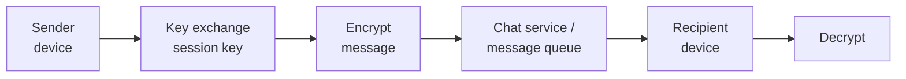

# Volo Chat System

## Overview

### Purpose
Volo is an End-to-End Encrypted Chat System that provides a secure and private messaging platform for both web and mobile users. It ensures user data confidentiality and protection from unauthorized access through robust encryption and authentication mechanisms.

### Value
This application prioritizes user privacy and security, offering encrypted end-to-end messaging. Its intuitive interface and feature set enhance user experience, fostering trust and engagement. By providing a secure alternative to mainstream messaging services, it empowers users to truly control their digital interactions.

### Scope
The scope includes developing and deploying a feature-rich messaging platform with authentication, key exchange, chat functionality, and additional features like contact management, search, invitations, profiles, and social media integration.

### Objective
The objective is to create a secure and private messaging platform where users can communicate confidentially without the risk of unauthorized access or surveillance. By prioritizing user privacy and implementing strong security measures, the goal is to provide a trustworthy environment for digital conversations.

The end-to-end encrypted chat system development aligns with Iagon's strategic goals of establishing a decentralized marketplace for storage and computing resources. Integrating secure messaging capabilities prioritizes data privacy, security, and accessibility within the Iagon ecosystem.

- **Data Privacy and Security**: Implementing end-to-end encryption ensures user communications are protected, enhancing data privacy and security across Iagon's decentralized marketplace.

- **User Trust and Confidence**: Prioritizing data privacy fosters trust among users, supporting Iagon's objective of building a transparent and trustworthy ecosystem.

- **Enhanced User Experience**: Volo promotes accessibility to Iagon's services, fostering transparency and inclusivity, and enhancing user experience.

- **Future Expansion**: Volo lays the foundation for future developments, supporting Iagon's vision of a comprehensive decentralized grid.

## Background Context
The project addresses a crucial security gap within Iagon's ecosystem, enhancing user trust and confidence.

### Pain Point
The absence of secure messaging leaves users vulnerable to privacy breaches, compromising trust and confidence in the platform.

### Alignment with Company Goals/Values
Developing this system reinforces Iagon's commitment to data privacy, security, and user trust, aligning with its mission.

### Impact on Existing Products
The implementation Volo sets Iagon apart, potentially attracting users seeking enhanced security and impacting existing products lacking similar privacy measures.

## Requirements
| Epic                   | Tasks                                                                                                                         |
|------------------------|-------------------------------------------------------------------------------------------------------------------------------|
| User Registration      | Users can register using OAuth with social accounts like Google or Twitter.                                                   |
| Device Registration    | - Users must register their first device to use the service.  - Generate two asymmetric key pairs: one for signing and one for messaging.  - Receive a random nonce from the server, sign it with the signing key, and send it along with device ID and public key pairs to the server.  - Server verifies and registers the device under the public key pairs. |
| Adding New Device      | - Users can add a new device to their account.  - Old Device: Generate random passphrases and construct a QR code.  - Old Device: Use Key Derivation Function (KDF) to generate a session key (S).  - New Device: Scan the QR code to get the passphrase and generate session key (S) using KDF.  - New Device: Generate two asymmetric key pairs: one for signing and one for messaging.  - Use session key (S) to encrypt messages for device registration.  - Old device sends user ID and session token to authenticate the new device with the server.  - New device generates a new device ID, signs and sends it to the old device along with newly generated public keys.  - Old device verifies the signature, signs the data with its signing key, and sends it to the new device.  - New device sends old device signature and data to the server for verification and registration, including publication to the blockchain. |
| Chat                   | Chat Message Backup:  - Users can back up their chat messages by subscribing to the Iagon storage service.  - To back up messages:  - User chooses a password or passphrase to generate a backup key using Password-Based Key Derivation Function (PBKDF).  - Backup: Messages requiring backup are encrypted using the backup key.  - The salt is sent along with the messages to the backup server for storage. |
| Contacts               | - Users can add other users to their contacts using their usernames for quicker discovery.                                      |
| Search                 | - Users can search for specific chats or users to initiate new conversations.                                                   |
| Invite Friends         | - Users can invite their friends via email or invitation links to join the platform.                                             |
| Groups                 | - Users can create groups with multiple members.  - Group creation/admin initiates key exchange with every member's devices for secure communication. |
| Profile                | - Users can set their username, description, and profile picture.                                                                |
| Social Accounts        | - Users can link their social media accounts for easier discovery by other users.                                                |
| Verify Conversation    | - Users can verify the security of conversations by comparing conversation safety numbers between each other and devices.  - This check protects against Man-in-the-Middle (MITM) attacks and can be performed through QR codes.  - Conversation safety numbers are generated by hashing the concatenation of available public keys of all users and devices involved in the conversation. |
| Key Exchange           | Before sending a message, user A must share the encryption key with user B.  - Sender (user A) performs key exchange with each of the receiver's (user B's) devices and its own devices using the following steps:  - Generation and Encryption  - Sender (user A) generates a random session key.  - The session key is encrypted with the public keys of receiver (user B) and sender's (user A's) devices.  - Sender (user A) signs the encrypted session key with its private key.  - Message Reception:  - Each device (belonging to user B and user A) receiving the message verifies the signature and decrypts the message to obtain the session key.  - Session Key Renewal:  - The session key can be regenerated after a certain time or a certain number of messages sent or received, ensuring ongoing security of communication.  - Message Encryption and Decryption:  - The shared session key is used to generate symmetric keys using Key Derivation Function (KDF).  - The sender encrypts the message with the generated symmetric key, and the receiver decrypts the message using the same key. |

 

## System Overview

### WebSocket Server
Users connect to establish web socket connection for real time message exchange. The websocket server registers every opened connection to the socket connection manager.

### Socket Connection Manager
It stores the information about the open connection of every user to the socket server.

### Key Distribution Server
All the public keys for the devices are stored and managed by the key distribution server.

### Web Server
It exposes API endpoints for all HTTP/HTTPS requests, which includes authentication, user information, group information etc.

### Chat Service
All the messages sent by users are handled by the chat service. It processes the messages and pushes to the message queue for all the destination devices.

### Message Queue
All the messages are first pushed to the message queue.

### Message Delivery Service
Message delivery service reads the message queue and delivers to the open web socket connection of the particular destination device. If there is no open connection, it pushes the pending messages to the database.

### App Database
All the information like user info, group info, profile info etc are stored in the app database.

### Key Store
All the keys for the users’ devices are stored at the key store.

### Pending Message Store
All the pending messages are stored in the pending message store. Messages are automatically deleted after a certain time or after reaching a certain count.

***Note: All the servers in the messaging system will be replaced by Iagon’s decentralized Compute.***

 
