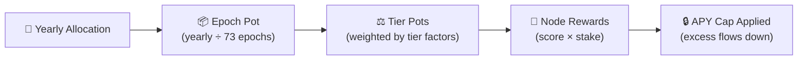
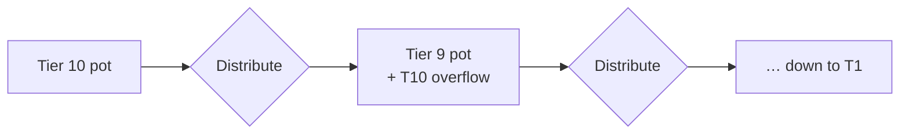

Storage Node
# Staking Overview

<br/>

**IAG token staking** ties economic commitment to storage provision on the Iagon network. Node operators and delegators lock IAG tokens to activate capacity. The required stake scales with committed storage and the token price, so participation stays aligned with network health. Withdrawals follow a **minimum staking period** (including a three-month unbonding path after retirement or undelegation) so capacity and data availability are not disrupted by sudden exits. In return, participants earn **IAG staking rewards** from a long-term emissions schedule. Rewards are allocated yearly, paid out by epoch, distributed across **performance tiers** with fair caps, and adjusted for node scores and stake - so strong, well-staked nodes are rewarded without letting any single tier capture the whole rewards pool. The sections below break down how stake amounts are calculated, how long tokens stay committed, and how rewards are computed and distributed.


## Calculation of Tokens to be Staked

As a node operator or a token delegator, staking IAG tokens demonstrates your commitment to the network. The staking amount depends on both the storage capacity being activated and the current IAG token price. Let's break it down:

- **Base USD Staked per GB**:

   - Initially set at $0.5 per gigabyte (GB) committed.
   - Represents the minimum staking requirement in USD for each GB of storage.

- **Alpha Coefficient**:

   - Alpha determines how sensitive the staking requirement is to the IAG token price.
   - Currently set at 0.9, but subject to adjustment based on market research.

- **Formula**:

   - Calculate the IAG tokens to be staked:
     ```
     IAG to be staked = Storage (in GBs) * (Base USD Staked per GB + Alpha * (Base USD Staked per GB / IAG Value))
     ```

- **Advantages**:
   - If the IAG token price drops, the amount of tokens required to stake increases, reducing circulating supply and potentially supporting price stability.
   - If the IAG token price rises, the value of staking rewards increases and the amount of tokens required to stake decreases, incentivizing new participation.

Remember, this dynamic adjustment balances commitment and accessibility within the Iagon network.


## Staking Period

To ensure the reliability and availability of storage services, a minimum staking period is established. For instance, when node operators stake their tokens; they can initiate their node's retirement instantly and the tokens will then be withdrawable 3 months later. The same timeframe applies for token delegators who wish to withdraw the tokens they delegated to a node - the withdrawal process can be initiated instantly, then the tokens will be withdrawable 3 months later.

This policy promotes a commitment to the network. This precaution safeguards against abrupt token removal, which could disrupt storage capacity availability and in extreme cases data availability, inconveniencing users.

<br/><br/><br/>

# Staking Rewards


## Staking Rewards Overview

Iagon distributes IAG staking rewards to node operators and their token delegators. Each year of the 15 year rewards program's duration has a dedicated rewards allocation, divided equally across every epoch in that year. Within each epoch, rewards are distributed across tiers based on tier factors, node performance scores, and stake amounts.

The system is designed around **fair distribution**. Per-tier APY caps ensure that no single tier dominates the rewards pool. When a tier's nodes hit their cap, the excess flows down to the next tier as a bonus, so strong performance at the top benefits the entire network rather than concentrating rewards.

:::tip
Read more about the performance requirements of each node tier [here](./tier-system).
:::

## How It Works



1. **Yearly allocation**: Each year has a fixed IAG rewards budget drawn from the 15-year schedule.
2. **Epoch pot**: The yearly allocation is divided equally across all 73 epochs in the year.
3. **Tier pots**: The epoch pot is split across tiers proportionally based on each tier's factor weight.
4. **Node rewards**: Within each tier, rewards are distributed to nodes proportionally based on their performance score multiplied by their stake amount.
5. **APY cap**: Each tier has an APY cap. If a node's reward exceeds its cap, the excess flows down to the next tier as a bonus.


## Reward Claim Schedule

Staking Rewards for epoch `n` are calculated at epoch `n+1` but are claimable at epoch `n+73`. Rewards can be claimed as they are available.


## Yearly Rewards Schedule

The rewards schedule spans 15 years with a gradually decreasing allocation each year, distributing rewards sustainably over the long term.

| Year     | Allocations  | Percent of total |
| -------- | ------------ | ---------------- |
| **1**    | 8,860,024.82 | 8.86%            |
| **2**    | 8,505,623.82 | 8.51%            |
| **3**    | 8,165,398.87 | 8.17%            |
| **4**    | 7,838,782.91 | 7.84%            |
| **5**    | 7,525,231.60 | 7.53%            |
| **6**    | 7,224,222.33 | 7.22%            |
| **7**    | 6,935,253.44 | 6.94%            |
| **8**    | 6,657,843.30 | 6.66%            |
| **9**    | 6,391529.571  | 6.39%           |
| **10**   | 5,316,014.889 | 5.32%           |
| **11**   | 5,316,014.889 | 5.32%           |
| **12**   | 5,316,014.889 | 5.32%           |
| **13**   | 5,316,014.889 | 5.32%           |
| **14**   | 5,316,014.889 | 5.32%           |
| **15\*** | 5,316,014.889 | 5.32%           |
| <sup>\*to be reduced to distribute rewards to initial nodes</sup> | **100,000,000** | **100%** |

Each year contains **73 epochs**. The epoch pot for any given epoch is the yearly allocation divided by 73.

:::info Extending the Schedule
If all tiers reach their APY caps and allocated rewards remain unspent at the end of a year, those excess rewards may be used to extend the rewards schedule beyond the initial 15 years. More information will be released about this closer to the end of the initial schedule.
:::

## Tier Factors

Each tier has a factor that determines its proportional share of the epoch pot. Higher tiers receive a larger share, reflecting stronger node performance and contribution to the network. Usually, excess rewards flow down to T4 and provide all included tiers with massive additional bonus rewards.

| Tier | Factor |
|------|--------|
| T1 | 0.05 |
| T2 | 0.15 |
| T3 | 0.25 |
| T4 | 0.30 |
| T5 | 0.40 |
| T6 | 0.50 |
| T7 | 0.70 |
| T8 | 0.80 |
| T9 | 0.90 |
| T10 | 1.00 |

Tier 0 nodes receive no rewards for that epoch. A node that drops to Tier 0 for a single epoch simply misses that epoch's rewards - it can recover in the following epoch and resume earning normally.

### How Tier Pots Are Calculated

The epoch pot is divided across tiers in proportion to their factor weights:

```
totalFactorWeight = sum of all tier factors (T0 through T10)
tierPot[T] = (tierFactor[T] / totalFactorWeight) × epochPot
```

For example, Tier 10 (factor 1.00) receives a larger share of the epoch pot than Tier 3 (factor 0.25), proportional to their factor weights.

### Empty-Tier Redistribution

If a tier has no eligible nodes in a given epoch, its pot doesn't go to waste - it's passed down to the next tier. This ensures the full epoch pot is always distributed to active participants, until every active tier has reached its APY cap.

### Within-Tier Distribution

Within a tier, each node's share of the tier pot is based on two factors: **performance score** and **stake amount**. The combination of both determines the node's weight relative to other nodes in the same tier.

```
nodeWeight = adjustedScore × stakeAmount
tierTotal  = sum of all nodeWeights in the tier
nodeReward = (nodeWeight / tierTotal) × tierPot
```

This means within any tier, a node earns more by maintaining a higher performance score, staking more, or both. Nodes in the same tier compete for their tier's pot based on the strength of their combined score and stake.

## APY Caps & Bonuses

To ensure fair distribution across all tiers, each tier has an **APY cap** - a maximum annualized return relative to a node's stake. This prevents any single tier from absorbing a disproportionate share of the rewards pool. When a node's calculated reward exceeds its tier's cap, the excess doesn't disappear - it flows down to the next tier as a bonus, benefiting nodes further down the ladder.

### Current APY Caps by Tier

<!-- Tier/APY table + chart: edit `.vitepress/theme/components/ApyCapTierLayout.vue` - `tiers` array (table) and `graph` string (Mermaid xychart). -->
<ApyCapTierLayout />

:::info
APY caps are subject to adjustment based on the observations of data collected over time.
:::

### Per-Node Cap Formula

The cap is applied per node, per epoch. With 73 epochs per year, each node's maximum reward in a single epoch is:

```
maxRewardPerEpoch = (capPercent / 100) × stakeAmount / 73
```

If a node's calculated reward for the epoch exceeds this amount, it receives the capped amount and the excess flows down.

### How Overflow Bonuses Work

Overflow bonuses are processed from the top tier downward: T10 → T9 → T8 → ... → T1. At each tier, rewards are distributed to nodes based on their weighted values. Any excess above a node's cap is collected and added to the next tier's pot before that tier is processed.



This cascading effect means lower tiers can receive bonuses from multiple higher tiers as overflow accumulates on the way down. The result is that strong performance at the top of the network benefits every tier below it.

:::tip Fair Distribution by Design
The overflow bonus mechanism ensures that rewards are distributed as broadly as possible. High-tier nodes are rewarded for strong performance up to their cap, and anything beyond that flows to the tiers below. No single tier can monopolize the rewards pool - the system self-balances so that all active participants benefit.
:::

### Key Behaviours

- **Empty-tier pass-through**: If a tier has no eligible nodes, its entire pot (including any overflow received from above) passes down to the next tier.
- **Accumulation**: A lower tier can receive overflow from multiple higher tiers as it cascades down through empty or capped tiers.
- **Tier 1 remainder**: Any excess from Tier 1 that exceeds nodes' caps becomes unallocated - it is not distributed further. These unallocated rewards may contribute to extending the rewards schedule.
- **Tier 0**: Receives no allocation and does not participate in the overflow chain.

## FAQ

### What happens if my node drops to Tier 0 for an epoch?

Your node does not earn rewards for that epoch. However, this is not permanent - if your node recovers to a higher tier in the following epoch, it resumes earning normally. A single bad epoch does not affect future earnings.

### How are rewards split between nodes in the same tier?

Proportionally based on each node's performance score multiplied by its stake amount. A higher score, a higher stake, or both will increase your share of the tier's pot relative to other nodes in the same tier.

### What happens if a tier has no active nodes?

Its pot is redistributed proportionally to the occupied tiers based on their factor weights.

### Can a lower-tier node earn more than expected?

Yes. When higher-tier nodes hit their APY caps, the excess flows down. A lower-tier node can receive bonus rewards from overflow cascading down from multiple tiers above it.

### Does my stake amount affect my rewards?

Yes. Within your tier, your share of the tier pot is proportional to your performance score multiplied by your stake amount. More stake means a larger weight, which means a larger share - but always subject to your tier's APY cap.

<br/>
